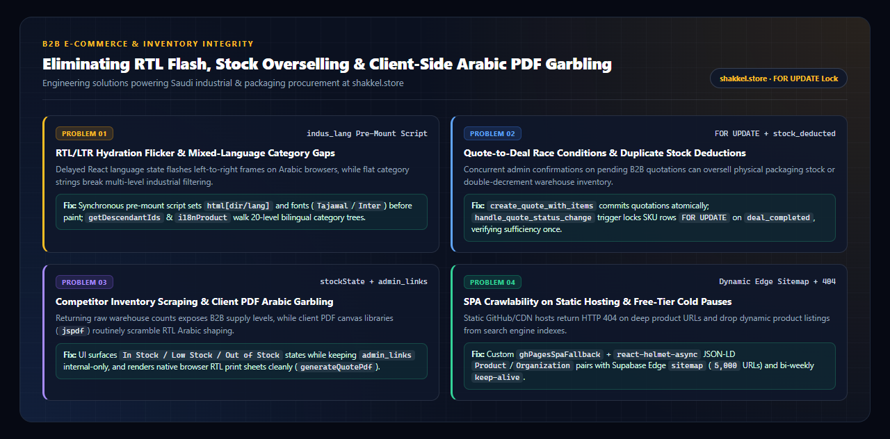
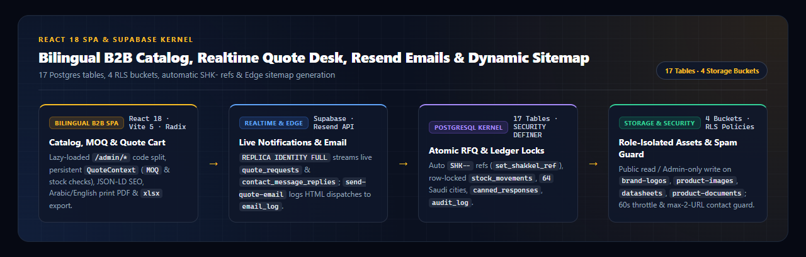
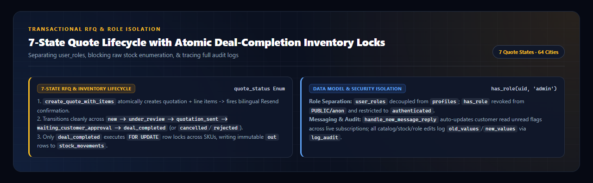
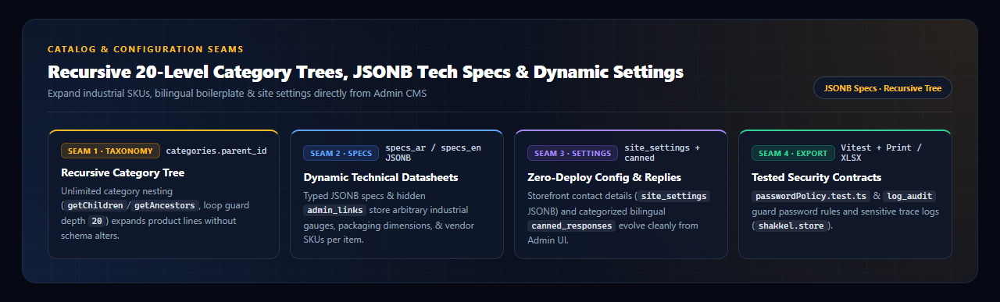

# Shakkel (شَكَّل) — Industrial B2B/B2C Procurement & Transactional RFQ Platform

**Bilingual Arabic RTL / English E-Commerce & Atomic Request-For-Quotation (RFQ) Platform (`React 18`, `TypeScript 5.8`, `Supabase PostgreSQL`, `Realtime WebSockets`, `Resend`, `JSON-LD SEO`) Powering `shakkel.store`**

[Visit Live Storefront (`shakkel.store`)](https://shakkel.store/) &nbsp;|&nbsp; [Problems Solved](#solving-b2b-catalog--inventory-integrity-problems) &nbsp;|&nbsp; [Architecture](#react-18-spa--supabase-kernel-architecture) &nbsp;|&nbsp; [Transactional RFQ](#transactional-rfq--role-isolation) &nbsp;|&nbsp; [Extensibility](#catalog--cms-extensibility-seams)

---

| Architectural Component | Verified Stack & Implementation | Operational Guarantee |
| :--- | :--- | :--- |
| **Bilingual Client SPA** | `React 18.3.1`, `TS 5.8.3`, `Vite 5.4.19`, `React Router 6.30.1`, `TanStack Query v5` | Zero-flash pre-mount `indus_lang` RTL switch + lazy `/admin/*` code split |
| **UI, Validation & Export** | `Tailwind CSS 3.4`, Radix UI suite, `Zod 4.4.3`, `Recharts 2.15.4`, `xlsx` | MOQ & stock-checked persistent cart + native RTL print PDF + Excel export |
| **Database Schema** | **`17` Postgres Tables**, `5` Enums (`app_role`, `quote_status`, `stock_movement_type`) | Auto `SHK-<BRAND>-<RAND>` refs + `64` Saudi cities + immutable `audit_log` |
| **Transactional Triggers** | `create_quote_with_items`, `handle_quote_status_change`, `has_role` | Row-locked (`FOR UPDATE`) inventory deduction exclusively on `deal_completed` |
| **Edge Functions & Live** | `send-quote-email` (Resend + `email_log`), `sitemap` (`5,000` products), Realtime | Instant admin quote/reply alerts (`REPLICA IDENTITY FULL`) + dynamic XML SEO |
| **Storage Buckets** | `brand-logos`, `product-images`, `datasheets`, `product-documents` | Public catalog `SELECT` paired with admin-only `has_role` write enforcement |

---

## Solving B2B Catalog & Inventory Integrity Problems

Industrial B2B procurement differs sharply from consumer retail: visitors browse nested hierarchies of technical packaging SKUs and request bulk non-priced quotations (RFQs) respecting Minimum Order Quantities (MOQs), competitors scrape raw warehouse inventory counts, delayed React i18n renders cause painful RTL flicker for Arabic buyers, and naive client-side PDF generators scramble Arabic calligraphy.

  

1. **Zero-Flash Pre-Mount RTL & Hierarchical Fallback (`index.html`, `categories.ts`, `i18nProduct.ts`):** Reads `localStorage["indus_lang"]` synchronously before React mounts to set `html[lang]`, `html[dir]`, and `Tajawal`/`Inter` typography cleanly. Product helpers walk primary -> alternate -> legacy localized fields and traverse multi-level parent/child industrial categories (`getDescendantIds`, `getAncestors`, depth cap `20`).
2. **Race-Free RFQ Commitments (`create_quote_with_items` + `handle_quote_status_change`):** Quotation headers and line items commit inside a single `SECURITY DEFINER` RPC. When an administrator promotes a quote across the 7-stage funnel to `'deal_completed'` (`stock_deducted = false`), a `BEFORE UPDATE` Postgres trigger locks matching `products` rows via **`FOR UPDATE`**, validates stock sufficiency, decrements `stock_qty`, records immutable `'out'` entries in `stock_movements`, and flips `stock_deducted := true`.
3. **Anti-Enumeration & Clean Arabic PDFs (`stockState`, `generateQuotePdf`):** Product cards surface availability states (`In Stock` / `Low Stock` / `Out of Stock`) while hiding exact warehouse quantities (`stock_qty`) and private vendor metadata (`admin_links`) from public APIs. Quotation exports render clean HTML print dialogs (`window.print()`) with native Arabic shaping ("Quotation Request — Prices Not Included") alongside `xlsx` spreadsheets.
4. **SPA Routing & Search Indexing (`ghPagesSpaFallback`, Edge `sitemap`):** Copies `index.html -> 404.html` for deep SPA URLs, emits canonical + OpenGraph + JSON-LD `Organization`/`Product` schemas via `react-helmet-async`, serves live XML sitemaps for up to `5,000` active products via Deno Edge Functions, and preserves free-tier uptime via scheduled bi-weekly keep-alive pings.

---

## React 18 SPA & Supabase Kernel Architecture

  

- **Realtime Admin Command Desk:** `REPLICA IDENTITY FULL` on `quote_requests`, `quote_request_items`, and `products`, combined with live message listeners (`contact_messages` and `contact_message_replies`), refreshes unread badges (`useAdminUnread`, `useUnreadReplies`) across admin and customer portals in real time.
- **Automated Email & Reply Triggers:** `handle_new_message_reply` automatically flips parent inbox status (`replied`, `is_read_by_user = false`), while `send-quote-email` dispatches bilingual customer/admin notifications via Resend API and audits delivery statuses into `email_log`.

---

## Transactional RFQ & Role Isolation

  

- **Clean Role & Auth Separation (`AuthContext`, `RouteGuards.tsx`):** Decouples `user_roles` (`admin`, `customer`) from mutable `profiles`, restricts `has_role()` to `authenticated`, auto-provisions customer roles on signup via `handle_new_user()`, enforces `>= 8` char + alphanumeric passwords (tested in `src/test/password.test.ts` with Vitest), and shields contact forms with 60s client throttling + max-2-URL SQL RLS regex checks.

---

## Catalog & CMS Extensibility Seams

  

1. **Recursive Taxonomy (`categories.parent_id`):** Self-referential hierarchy expands unlimited industrial categories and nested subcategories without schema migrations.
2. **Typed JSONB Datasheets (`specs_ar`/`specs_en` + `admin_links`):** Adapts seamlessly to packaging dimensions, machinery tolerances, and internal supplier links hidden cleanly from public buyers.
3. **Zero-Deploy CMS & Macros (`site_settings`, `canned_responses`, `audit_log`):** Bilingual storefront contact blocks, 64 Saudi delivery cities, categorized quick-replies, and full admin mutation logs are configured directly in-app.

---

> [!NOTE]
> Client production source code remains proprietary; this repository documents the verified production platform powering [shakkel.store](https://shakkel.store/).

[Visit Live Storefront (`shakkel.store`)](https://shakkel.store/) &nbsp;|&nbsp; [Shakkel Learning Hub](https://learn.shakkel.store/) &nbsp;|&nbsp; [Portfolio](https://abdulqader-alshihabi.github.io/) &nbsp;|&nbsp; [LinkedIn](https://www.linkedin.com/in/abdulqader-alshihabi-859b19260/) &nbsp;|&nbsp; Built by **Abdulqader Alshihabi**

